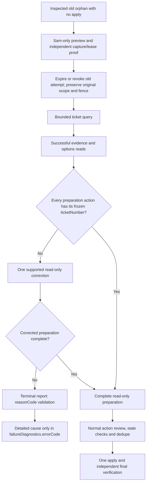

# Ticket 63978: preparation construction and result reporting

The original run picked up ticket 63978 and started MCP work at 00:01:12 UTC
on 11 October 2026. Its bounded query, evidence recovery and field-options
read all succeeded. The deployed startup guard and automatic resolution-field
expansion were present. Those reads show no upstream throttle or failed request.

The complete saved Agent workflow shows two preparation actions and a result
report, with no intent or apply action. Its final diagnostic says preparation
omitted the required action `ticketNumber` after the permitted correction, and
the callback used `plan_validation_failed` as an unsupported outcome reason.
Neither preparation appears in the complete correlated MCP captures. Their
original arguments are unavailable from the saved workflow inspector, so the
specific omitted field comes from the saved Agent diagnostic rather than a
retained server-side validation response. The no-apply conclusion is supported
by the complete workflow, captures and independent coordinator write guards.

At 00:02:45 UTC the provider returned `completed`; the coordinator recorded
`orphan_recovered` with `result_callback_missing` and retained an attention fence.
A provider completion is not proof of completed ticket triage. At investigation
the ticket was unchanged in New Calls with no notes.

## Implementation

1. The generated input checks `actions[i].ticketNumber` before both preparation
   calls. The frozen candidate array and immutable ID cannot substitute for it.
   Tool descriptions repeat this at the actual preparation boundary. Required
   fields, one-correction allowance and all approval/stale/identity gates remain.
2. The generated result instructions use the Reporter's actual stage/reason
   enums. A preparation error uses outcome `not_attempted`, stage `triage_apply`
   and reason `validation`; `plan_validation_failed` belongs in diagnostic
   `errorCode`. Platform argument rejection must not invent execution telemetry.
3. Sam-only `/admin/triage-construction-recovery` requires a complete inspected
   workflow containing only query, evidence and options reads, one or two
   schema-rejected preparation calls and the schema-rejected result report.
   Independent private captures must contain exactly those three successful,
   correlated read calls, one candidate and its matching immutable evidence ID.
   Capture gaps, errors, pending reads, trace gaps, writes and operations reject
   recovery. The coordinator additionally requires its guarded completed query,
   no intent/write check/operation/unsafe claim, an expired or revoked old lease,
   a fresh exact provider/run/conversation completion and the original fence.
4. Preview changes no state. Scheduling requires an idle coordinator, preserves
   the original time window and fence, revokes the old attempt and schedules one
   exact ticket through normal review. Durable duplicate recovery checks include
   all operator recovery event types. Denials and ambiguous writes stay blocked.

## Verification

Synthetic regressions reproduce the missing nested field and invalid reporting
reason, test the accepted canonical failure report, and exercise the actual
coordinator module's preview, single-ticket scheduling and refusal gates. The
real private captures also pass the content-free proof function. No customer
body, note or captured argument object is copied into these tests or this record.

The full MCP suite passed 890 Vitest cases and three instruction-serialization
cases, with the policy checksum check and TypeScript build. The trigger's actual
module suite and local Miniflare verifier passed; its syntax build also passed.
Production deployment and the exact-ticket recovery are pending live verification.
The existing monitor remains paused. These checks improve construction and
recovery; they do not prove that every possible Agent error is eliminated.
